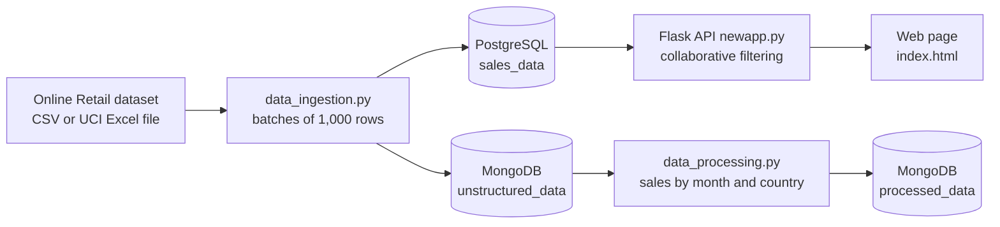

# E-commerce Recommendation Pipeline

A batch data pipeline for the UCI Online Retail dataset (541,909 transactions from a UK online retailer). It loads the data in batches into PostgreSQL and MongoDB, aggregates sales by month and country, and serves product recommendations from a Flask API that uses user-based collaborative filtering. Everything runs locally with Docker Compose.

Group project (four students) for the module Data Engineering 1: Big Data Databases, MSc Applied Data Science and Analytics, SRH University of Applied Sciences Heidelberg (Hamburg campus), February 2025.

## At a glance

| | |
|---|---|
| **Data** | UCI Online Retail: 541,909 rows, 1 Dec 2010 – 9 Dec 2011, 4,372 customers, 4,070 products, 38 countries |
| **Pipeline** | Batch ingestion (1,000 rows per batch) → PostgreSQL + MongoDB → aggregation in MongoDB → recommendation API |
| **Recommender** | User-based collaborative filtering: cosine similarity between customers, 5 most similar customers, popularity fallback |
| **Stack** | Python, pandas, SQLAlchemy, PostgreSQL, MongoDB (PyMongo), scikit-learn, Flask, Docker Compose, pytest, HTML/JavaScript with Bootstrap |
| **Tests** | 26 automated tests (pytest), no database server needed |
| **Status** | Runs locally with Docker Compose; not deployed |

## How it works



1. **Ingestion** (`data_ingestion.py`). Reads the dataset in batches of 1,000 rows, parses invoice dates, stores customer IDs as text (`17850`, not `17850.0`), and writes each batch to the PostgreSQL table `sales_data` and the MongoDB collection `OnlineRetail.unstructured_data`. If `sales_data` already contains rows, ingestion is skipped, so restarting the stack does not duplicate data. `INGEST_MODE=replace` empties both stores and reloads.
2. **Processing** (`data_processing.py`). Reads the documents from MongoDB, calculates `TotalPrice` (quantity × unit price), groups sales by month and country, and writes the result to `OnlineRetail.processed_data` (314 documents for the full dataset), replacing the previous run's output.
3. **Recommendations** (`newapp.py`). `POST /train` loads `sales_data` and builds a customer × product matrix of net quantities. Cancellations are negative rows and are added up with the original purchase, so a fully cancelled order counts as nothing. Rows without a customer ID (135,080) are left out of the matrix. For a known customer, the API finds the 5 most similar customers (cosine similarity) and ranks the products they bought by similarity × quantity, leaving out products the customer has already bought. Unknown customers get the products with the highest net quantity sold.

## Results from a full run

From a run on my laptop with the full dataset:

| Step | Result |
|---|---|
| Ingestion | 541,909 rows in PostgreSQL and 541,909 documents in MongoDB; about 17 seconds from CSV and 46 seconds from the UCI Excel file, with identical results |
| Processing | 314 month × country documents in `processed_data` |
| Training | Matrix of 4,326 customers × 3,649 products |
| Customer 17850 (3 recommendations) | 21733 RED HANGING HEART T-LIGHT HOLDER (34.49), 22789 T-LIGHT HOLDER SWEETHEART HANGING (17.66), 84077 WORLD WAR 2 GLIDERS ASSTD DESIGNS (17.38) |
| Unknown customer (fallback) | 22197 SMALL POPCORN HOLDER (56,450), 84077 WORLD WAR 2 GLIDERS ASSTD DESIGNS (53,847), 85099B JUMBO BAG RED RETROSPOT (47,363) |

Customer 17850 had bought 24 different products; none of the three recommendations is among them. The quality of the recommendations has not been evaluated against held-out purchases (see Limitations).

## Getting started

### Prerequisites

- Docker Desktop
- Python 3.11 or later (only for running the tests or the scripts outside Docker)

### 1. Get the code and the data

```bash
git clone https://github.com/samu2421/ecommerce-recommendation-pipeline.git
cd ecommerce-recommendation-pipeline
cp .env.example .env    # optional: change the database credentials
```

Download the dataset from the [UCI Machine Learning Repository](https://archive.ics.uci.edu/dataset/352/online+retail), unzip it and put `Online Retail.xlsx` into the `data/` folder. Then set in `.env`:

```bash
DATASET_PATH=data/Online Retail.xlsx
```

A CSV export of the same data also works; by default the pipeline looks for `data/online_retail.csv` (dates in `dd/mm/yy HH:MM` format). The data files are not part of this repository.

### 2. Start the pipeline

```bash
docker compose up --build -d
```

This starts PostgreSQL, MongoDB, the one-off ingestion job and the API on port 5001. Follow the ingestion with `docker compose logs -f ingestion`; it prints a message when it has finished. If port 5432 is already used on your machine, set `POSTGRES_PORT` (for example `POSTGRES_PORT=5433`) in `.env`.

The database credentials only take effect when the PostgreSQL volume is first created. If you change them later, either keep the original values or remove the old data with `docker compose down -v` and start again.

### 3. Train the model and get recommendations

```bash
curl -X POST http://localhost:5001/train
curl "http://localhost:5001/recommendations/17850?n=3"
```

Or open `index.html` in a browser, click **Train Model**, enter a customer ID (for example `17850`) and click **Get Recommendations**.

### 4. Aggregate sales in MongoDB (optional)

```bash
python3 -m venv .venv && source .venv/bin/activate
pip install -r requirements.txt
python data_processing.py
```

### Check the databases

```bash
docker exec -it postgres_db psql -U samiksha -d ecommerce_data -c "SELECT COUNT(*) FROM sales_data;"
docker exec -it mongodb mongosh OnlineRetail --quiet --eval "db.unstructured_data.countDocuments({})"
```

Use the `POSTGRES_USER` and `POSTGRES_DB` from your `.env` if you changed them.

### Stop

```bash
docker compose down        # keeps the data volumes
docker compose down -v     # also deletes the loaded data
```

## API

| Method and path | Description |
|---|---|
| `GET /test` | Health check |
| `POST /train` | Loads `sales_data` and builds the model; returns the number of customers and products in the matrix |
| `GET /recommendations/<customer_id>?n=5` | Up to `n` recommendations (1–10, default 5) as `stock_code`, `description` and `score`. Unknown customers get the popularity fallback. Returns 503 if the model has not been trained and 400 if `n` is not a number |

The model is kept in memory, so call `POST /train` again after restarting the API.

## Configuration

All settings are environment variables; `.env.example` lists them with comments.

| Variable | Purpose |
|---|---|
| `POSTGRES_USER`, `POSTGRES_PASSWORD`, `POSTGRES_DB`, `POSTGRES_PORT` | PostgreSQL container and host port. The defaults in `docker-compose.yml` are local development values only |
| `DATABASE_URL`, `MONGO_URI` | Connections used when running the scripts outside Docker |
| `DATASET_PATH` | Location of the CSV or Excel file |
| `INGEST_MODE` | Empty (default): load only into an empty table. `replace`: empty both stores and reload |
| `FLASK_HOST`, `FLASK_PORT`, `FLASK_DEBUG` | API server settings (debug off by default) |

## Testing

```bash
python3 -m venv .venv && source .venv/bin/activate
pip install -r requirements-dev.txt
pytest
```

The 26 tests cover the recommender (net quantities, cancellations, anonymous rows, popularity fallback, exclusion of already-bought products, the 1–10 limit, customer ID formats) and the ingestion (first load, skip on re-run, replace mode, customer IDs stored as whole numbers). They use small in-memory examples, a temporary SQLite file and a fake MongoDB collection, so no database server is needed.

## Repository structure

```
data_ingestion.py      Batch ingestion into PostgreSQL and MongoDB
data_processing.py     Aggregation of sales by month and country in MongoDB
newapp.py              Flask API and recommendation engine
init_postgres.sql      Table and index for sales_data (runs on first start of the container)
docker-compose.yml     PostgreSQL, MongoDB, ingestion job and API
Dockerfile             Image for the ingestion job and the API
index.html, script.js, styles.css   Web page for the API
tests/                 pytest suite
data/                  Place for the dataset (not included)
```

## Limitations

- **Recommendation quality is not measured.** There is no evaluation on held-out purchases (for example precision@k), so the results show that the method works, not how good it is.
- **Batch only.** New transactions require re-running ingestion and training.
- **Everything is in memory.** Training loads the whole table into pandas and builds a dense customer × customer similarity matrix (about 4,300 × 4,300). This works for this dataset but would not scale to millions of customers.
- **Quantity, not preference.** Scores use purchased quantities, so wholesale customers who order large quantities have a strong influence.
- **MongoDB holds a copy of the same tabular rows** plus the monthly aggregates; it is used as a document store, not for different kinds of data.
- **No authentication** on the API, and the default database credentials are for local use only.

## Possible next steps

- Evaluate the recommender on a time-based train/test split
- Use a sparse matrix or an approximate nearest-neighbour search to scale to more customers
- Schedule ingestion and processing with an orchestrator such as Airflow
- Add incremental loading instead of full reloads

## Credits

- Dataset: Chen, D. (2015). *Online Retail* [Dataset]. UCI Machine Learning Repository. https://doi.org/10.24432/C5BW33. Licensed under [CC BY 4.0](https://creativecommons.org/licenses/by/4.0/). The dataset is not redistributed in this repository.

## Author and project context

Samiksha Dhere. The project was a group assignment (four students) for Data Engineering 1: Big Data Databases; the commits in this repository are my own work. For the module, I also ran the ingestion container on an AWS EC2 instance (t2.micro); the deployment steps are not part of this repository.

In November 2026 I cleaned up the repository: removed the committed virtual environment and dataset, moved configuration to environment variables, fixed the customer ID storage, separated the ingestion job from the API in Docker Compose, made ingestion repeatable, corrected the handling of cancellations, and added the test suite. This update was carried out with AI coding assistance.
